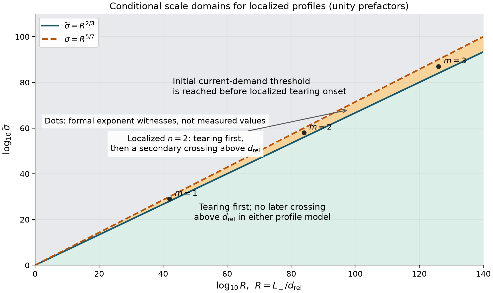
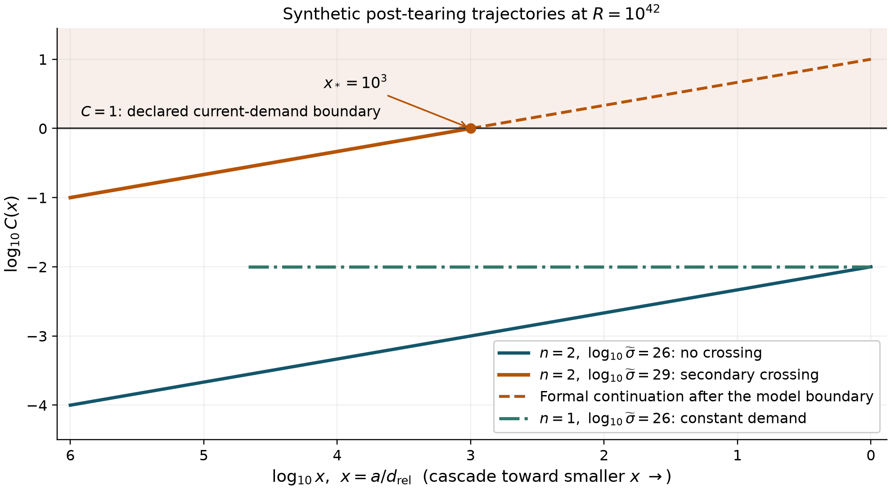

# Scale ordering in localized tearing-mediated relativistic turbulence

**Taylor Kalin**  
https://taylorkalin.com · teylersf@gmail.com  
ORCID: [0009-0003-9000-9315](https://orcid.org/0009-0003-9000-9315)  
29 October 2026 · Reproducible audit report

## Outcome

We found no demonstrated error in the principal scaling derivations or the
Appendix controls checked in Boldyrev and Loureiro, *Tearing-mediated Alfvénic
Turbulence in a Relativistic Plasma*, ApJ 979, 232 (2025),
[doi:10.3847/1538-4357/ada28a](https://doi.org/10.3847/1538-4357/ada28a).
The supported result is a conditional parameter-domain clarification. It follows
from equations the source itself prints. The paragraph after its Eq. (25),
page 4, already makes the relevant below-inertial-scale qualification.

This report records a qualified audit outcome. It does not allege a wrong
tearing exponent, a new observed plasma regime, an omitted charge-starvation
mechanism, or a corrected spectrum. No separate correction-paper submission
is warranted by the present evidence.

## Source and verification scope

The complete supplied eleven-page journal article was read, including Appendix
A, captions, footnotes and bibliography. After the user completed the publisher's
human check, its accessible full article text and all 78 displayed equation
TeX strings were compared with the supplied edition. A fresh publisher PDF
download was not obtained; fresh-download byte identity is not claimed.
Source hashes, edition qualifications and primary links are recorded in
[source-provenance.json](source-provenance.json).

Independent checks cover main scaling identities, exact rational exponent
controls, Appendix algebra and selected high-precision integral and
hypergeometric relations. These are bounded mathematical checks. They are
not a new solution of the complete inner eigenproblem, a particle simulation,
or independent human peer review.

## Conditional domain map

Let $R=L_\perp/d_{\rm rel}>1$, $x=a/d_{\rm rel}$, and
$s=\widetilde\sigma$ be the source's fluctuation magnetization. Keep its
background inertial length and density fixed, its cascade phenomenology,
and its two profile classes: $n=1$ for Harris and $n=2$ for localized profiles.
The source scalings give

$$
x_t\sim R^{n/(4+5n)},\qquad
\frac{b_a}{b_0}\sim R^{-1/3}x^{(2n+1)/(3n)}.
$$

The amplitude matches the initial aligned cascade at $x_t$. Its constant-flux
spectrum exponents are $-3$ for Harris and $-8/3$ for localized profiles;
these checks retain the source results. Define a dimensionless current-demand
proxy using the same scaling conventions:

$$
C(x)=s\left(\frac{b_a}{b_0}\right)^2x^{-2}
\sim sR^{-2/3}x^{-2(n-1)/(3n)}.
$$

For Harris profiles, $C$ is constant in the continued tearing range. If the
initial transition occurs below its current-demand threshold, this particular
constraint does not cause a later crossing. For localized profiles,
$C\sim sR^{-2/3}x^{-1/3}$, and the source's Eq. (25) is

$$
x_*\sim s^3R^{-2}.
$$

Consequently, initial localized tearing before the unmodified current-demand
crossing requires $s\ll R^{5/7}$, whereas keeping the prospective secondary
crossing well below the inertial scale requires $s\ll R^{2/3}$. In a correlated
two-parameter limit, both orderings can be separated as

$$
R^{2/3}\ll s\ll R^{5/7}
\quad\Longrightarrow\quad
1\ll x_*\ll x_t.
$$

This is an explicit consequence of the retained model, not a correction to
Eq. (25). The source already discusses the expected alternative $x_*<1$ in
astrophysical applications. At **fixed** $s$, its Eq. (25) gives $x_*\to0$
as $R\to\infty$, consistent with that expectation. The displayed intervening
window instead uses a correlated family $s=R^p$, $2/3<p<5/7$.

The figure sets omitted proportionality constants to unity only to draw
illustrative boundaries. Equality lines do not represent strongly separated
asymptotic regimes. The orange interval spans just $R^{1/21}$ in magnetization.
Its geometric midpoint has a factor $R^{1/42}$ to each boundary. At $R=10^{12}$,
that factor is about 1.93; finite coefficients can therefore matter greatly.
Margins exceeding a chosen factor $K$ on both sides require $R>K^{42}$.

An exact formal witness is $R=10^{42m}$, $s=10^{29m}$ with positive integer
$m$. It gives $x_t=10^{6m}$, $x_*=10^{3m}$ and $C(x_t)=10^{-m}$ under the
declared unity prefactors. These enormous values demonstrate the exponent
ordering; they do not establish an astrophysical realization.

The second figure uses $R=10^{42}$. The localized $s=10^{26}$ trajectory
remains below the proxy threshold through $x=1$; $s=10^{29}$ reaches it at
$x=10^3$. The Harris control at $s=10^{26}$ is constant. After the prospective
crossing, the same assumptions need reassessment; the dashed line supplies
no post-crossing spectrum, heating rate, reconnection rate or dissipation law.

## What remains unresolved

The source requires a strong guide field, but guide-field magnetization and
fluctuation magnetization are distinct. The stated ordering alone does not
universally exclude the formal correlated family. Conversely, a particular
physical system may exclude it through finite size, particle distributions,
kinetic damping, radiation, density changes or changing enthalpy. The current
threshold also has convention-dependent finite coefficients. Actual physical
occupancy cannot be decided from a two-exponent diagram.

The broader competition between tearing, current supply and the kinetic cutoff
is prior work. Loureiro and Boldyrev's
[2018 pair-plasma study](https://doi.org/10.3847/2041-8213/aae483) already
derives the corresponding profile-dependent tearing spectra in its model.
Demidov and Lyubarsky's
[arXiv:2410.16167v1](https://arxiv.org/abs/2410.16167v1) discusses current
limitations, finite scale separation and distribution-dependent kinetic
cutoffs. The complete five-page 2018 article and pages 7–11 of that eighteen-page
preprint were read for this comparison. Its later journal edition was not
audited here. No broad novelty claim about tearing/current-starvation
competition is made.

## Reproduction and evidence

The [original producer](reproduction/run_audit.py) uses exact rational
exponents and logarithmic coordinates. Its 144 finite cases, 24 transition
equalities and three formal witnesses are synthetic controls, not experimental
samples. Floating point is used for drawing. Separate implementations do not
import the producer. See [COMPUTATIONAL_METHODS.md](COMPUTATIONAL_METHODS.md),
[REPRODUCIBILITY.md](REPRODUCIBILITY.md), the [data](data/) and original
independent review records in [audit](audit/).

## Authorship, funding and disclosure

Taylor Kalin is the author and self-funded this work. No outside funding or
competing financial interest was reported. AI systems assisted source reading,
mathematical checking, programming and drafting. Internal independent checks
and public GitHub availability do not constitute external human peer review.
Original explanatory text and figures are CC BY 4.0; code is MIT licensed.
Third-party works retain their own rights.
